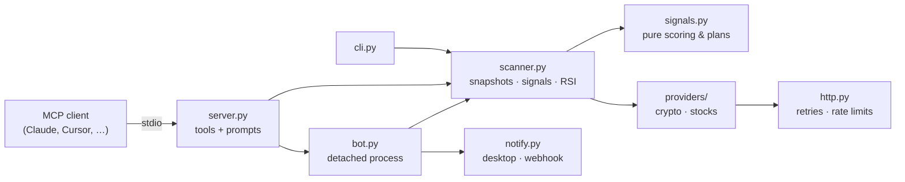

# rs-radar

[](https://github.com/ajinkya-cs/rs-radar/actions/workflows/ci.yml)
[](pyproject.toml)
[](LICENSE)
[](https://modelcontextprotocol.io)
[](#support)

**Relative-strength & momentum radar for crypto and US stocks, as an MCP server.**

Ask your AI assistant *"what's strong vs BTC right now?"*, *"who led the bounce since 20:24?"* or
*"start the bot and ping me on high-confidence setups"*. rs-radar does the market-data plumbing and
the statistics; your MCP client (Claude Code, Claude Desktop, Cursor, …) does the conversation.

- **Relative strength that means something.** Every "vs benchmark" figure is *beta-adjusted*: a coin
  that normally moves 2× BTC gets no credit for rising 2% when BTC rises 1%.
- **Signals, not noise.** A setup must clear hard gates (outperformance, a ≥3σ move for *that*
  instrument, a volume surge, an intact uptrend) before it's scored, and alerts fire only at high confidence.
- **Trade plans included.** Entry, max entry, structure/ATR stop-loss, and 1.5R / 3R targets.
- **A bot that outlives your chat.** Desktop notifications (macOS/Linux) and optional Discord/Slack
  webhooks, with cooldowns and a health heartbeat.
- **Watchlists from screenshots.** Drop an image of your exchange watchlist into the chat; your
  assistant reads the tickers and rs-radar validates each against live data.
- **No API keys required.** Crypto: CoinGecko + Binance public data (Crypto.com fallback).
  US stocks: Yahoo Finance chart data, benchmarked against SPY.

```text
$ rs-radar since --top 5
crypto | BTC 84640.5 | 5m -0.00%  15m +0.06%  1h +0.04%  4h +0.06% | as of 2026-10-03T08:50+00:00
anchor 2026-10-03T07:59+00:00 | benchmark +0.10% since | 47/88 beating
symbol  change_pct  vs_benchmark_pct  beta_adjusted_pct  beta  volume_ratio
    AR        7.61              7.52               7.45  1.73          77.8
   ZRO        4.43              4.34               4.14     3           2.5
  KITE         2.3              2.21               2.24  0.68             1
   WLD        1.99              1.89                1.7     3           1.5
  MINA        1.46              1.36                1.3  1.65           1.4
```

## Quick start

rs-radar runs locally via [uv](https://docs.astral.sh/uv/getting-started/installation/). Nothing to
clone; `uvx` fetches and runs it.

**Claude Code**

```bash
claude mcp add rs-radar -- uvx --from git+https://github.com/ajinkya-cs/rs-radar rs-radar serve
```

**Claude Desktop, Cursor and other MCP clients**: add to the client's MCP config
(`claude_desktop_config.json`, `.cursor/mcp.json`, …):

```json
{
  "mcpServers": {
    "rs-radar": {
      "command": "uvx",
      "args": ["--from", "git+https://github.com/ajinkya-cs/rs-radar", "rs-radar", "serve"]
    }
  }
}
```

Then just ask: *"Scan crypto for relative strength"*, *"RSI on SOL, ETH and AR on the 4h"*,
*"Give me a trade plan for NVDA"*, *"Start the bot for crypto and stocks"*.

## Slash commands

The server ships MCP prompts, which clients expose as slash commands. In Claude Code they appear as
`/mcp__rs-radar__<name>`:

| Command | What it does |
|---|---|
| `scan` | Benchmark move, breadth, unusual 5m moves, leaders and laggards |
| `signals` | High-confidence long setups with entry / SL / TP |
| `rsi` | RSI for given symbols, or the most overbought / oversold names |
| `since-low` | Who led the bounce since the benchmark's recent low (or a time like `20:24`) |
| `bot-start` / `bot-status` | Start the notification bot / check its health and recent alerts |
| `watchlist-from-image` | Read tickers from an attached screenshot and add them to a watchlist |

## Tools

| Tool | Description |
|---|---|
| `market_overview` | Everything moving now: breadth, unusual moves, gainers (5m/15m/1h), strongest vs benchmark (1h/4h), losers |
| `relative_strength` | Rank by beta-adjusted outperformance over `5m`, `15m`, `1h` or `4h` |
| `top_movers` | Raw % gainers or losers over a window |
| `strength_since_low` | Performance since the benchmark's recent low or a given time |
| `find_signals` | High-confidence setups across the universe, your watchlist, or both |
| `rsi` | Wilder RSI (`1h`/`4h`/`1d`) for symbols or a market's top 50, filterable by zone |
| `trade_plan` | Trend context and a long plan for any symbol |
| `watchlist_add` / `_remove` / `_show` | Per-market watchlists, validated against live data |
| `bot_start` / `_stop` / `_status` / `_alerts` | Control the background bot |

Every tool takes `market: "crypto" | "stocks"`. Crypto covers the top 200 by market cap (stablecoins,
wrapped and liquid-staking duplicates removed) against **BTC**; stocks cover ~100 US large caps
against **SPY**.

## The bot

```bash
rs-radar bot start --market crypto --market stocks --min-confidence 85
rs-radar bot status
rs-radar bot stop
```

Or from chat: *"start the bot on my watchlist at confidence 90"*. The bot runs as a detached process,
so it keeps running after you close the MCP client. Each cycle it:

1. checks the market is live with one cheap request, so a closed stock market costs nothing;
2. scans the universe and/or your watchlist;
3. alerts on the single best new setup per market, then puts that symbol on cooldown (default 2h,
   persisted across restarts);
4. writes a heartbeat, so `bot status` can tell *running* from *healthy*.

Notifications look like `LONG AR · 88/100` / `Entry 4.583  SL 4.3235  TP 4.9673 / 5.3536`. Set
`RS_RADAR_WEBHOOK_URL` to also post to Discord or Slack.

## How signals work

Momentum is measured on 1-minute bars aligned to the benchmark's clock. For each instrument:

| Feature | Definition |
|---|---|
| Excess return | 5m return − β × benchmark 5m return, with β estimated on *prior* history only |
| Surprise | Excess return ÷ the instrument's own typical 5m excess (z-score) |
| Participation | Last 5m volume ÷ median 5m volume |
| Confirmation | 60m breakout, positive 15m & 1h excess, held a benchmark dip, persistence |
| Trend filter | Price > EMA20 > EMA50 on 4h (crypto) / 1h (stocks), ≤ 3 ATR above EMA20 |

Hard gates must pass (crypto: ≥ 1.5pp excess, ≥ +1% raw, ≥ 3σ, ≥ 2× volume; stocks use 0.5pp / +0.4%),
then confidence (0–100) rewards independent confirmations. Signals are suppressed whenever data isn't
live or the window spans a session gap, so an overnight stock gap can't masquerade as a 5-minute
breakout. Full details and rationale: [docs/methodology.md](docs/methodology.md).

## CLI

Everything is also available in the terminal:

```bash
uvx --from git+https://github.com/ajinkya-cs/rs-radar rs-radar scan              # market overview
rs-radar signals --market stocks --min-confidence 80
rs-radar rsi btc eth sol --interval 1d
rs-radar since --at 20:24                                                         # strength since a time
rs-radar plan NVDA --market stocks
rs-radar watchlist add sol ar zro && rs-radar watchlist show
```

Add `--json` to any analysis command for machine-readable output.

## Configuration

All optional, via environment variables (set them in your MCP client's `env` block):

| Variable | Purpose |
|---|---|
| `COINGECKO_API_KEY` | CoinGecko demo key for higher rate limits |
| `COINGECKO_PRO_API_KEY` | CoinGecko paid key (takes precedence) |
| `RS_RADAR_WEBHOOK_URL` | Discord/Slack-compatible webhook for bot alerts |
| `RS_RADAR_HOME` | Data directory for watchlists and bot state (default: OS user-data dir) |

Keys are read from the environment only and never written to disk or logs.

## Data sources & limitations

- **Crypto**: [CoinGecko](https://www.coingecko.com/en/api) for the market-cap universe;
  [Binance public market data](https://developers.binance.com/docs/binance-spot-api-docs/rest-api/market-data-endpoints)
  for candles, with [Crypto.com Exchange](https://exchange-docs.crypto.com/exchange/v1/rest-ws/index.html)
  as fallback. Coins listed on neither (e.g. some exchange tokens) are skipped and reported.
- **US stocks**: Yahoo Finance's public chart endpoint. It's unofficial, free and keyless, but has no
  SLA. It's fine for personal research; for production use, implement a provider for a licensed
  feed (see [CONTRIBUTING.md](CONTRIBUTING.md)). Yahoo has no 4h bars, so stocks use 1h for trend.
- Public endpoints rate-limit. All requests share one client with bounded concurrency and backoff.
- Tested on macOS and Linux. The core works on Windows; desktop notifications there are not yet supported.

## Architecture



Analytics (`indicators.py`, `signals.py`) are pure functions with no I/O; providers implement one small
`Protocol`, so adding a market is one file plus tests.

## Development

```bash
git clone https://github.com/ajinkya-cs/rs-radar && cd rs-radar
uv sync
uv run pytest                      # unit + in-process MCP tests, no network
uv run ruff check . && uv run mypy # lint & strict type-check
```

See [CONTRIBUTING.md](CONTRIBUTING.md) for conventions and how to add a provider or signal.

## Roadmap

- [ ] Alpaca provider (free real-time IEX data with a key) as an alternative to Yahoo
- [ ] Windows toast notifications and a Telegram notifier
- [ ] Short setups (relative weakness) alongside longs
- [ ] Backtest harness to calibrate confidence thresholds on recorded data

## Support

rs-radar is free and MIT-licensed. If it helped you catch a move, a tip keeps it maintained. ☕

| Coin | Network | Address |
|---|---|---|
| **BTC** | Bitcoin | `bc1qetx8qf06jcsh4hw38t80g86er5xgmhkgeyncwc` |
| **ETH**, USDC, USDT | Ethereum (ERC-20) | `0x01E49D471D26f490A75c35bd959e5f53F5Ef0F70` |
| **SOL**, USDC | Solana (SPL) | `B9sZeEjQjVpmjUV7yXQQumZ9jnorBH8go6EHZiMC5uFj` |

Please double-check the network before sending: funds sent on the wrong network can't be recovered.
Stars, bug reports and PRs are just as appreciated.

## Disclaimer

rs-radar is a research tool. Its output is statistical observation, **not financial advice**. Markets
can and do move against any setup. Size positions so that being wrong is affordable.

## License

[MIT](LICENSE)
